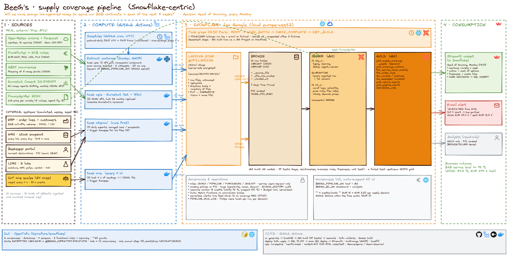

# BeeG's data platform · *Honey with a groove* 🐝

**Will we have enough lab-approved honey to serve our B2B contracts in each of the next 8 weeks?**

BeeG's is a traceable honey trader (60 partner beekeepers, 14,400 hives, 110 B2B customers, ~€1.7 M of revenue). Honey is harvested once a year but sold every week. In 2025, after the poor 2024 harvest (France -28 %), **1 kg out of 6 ordered was not delivered on time: €294 k of revenue lost**. This platform combines stock, lab results, the order book, the beekeepers' harvest declarations, hive scales, weather, bloom and import prices. Every Monday, it tells the Head of Sourcing which variety will run short, when, and what to do about it.

Data Engineering & Cloud Infrastructure project, Albert School. Team: Kelsy NGUYEN (business case, sources), Philomène CHOLET (ingestion, orchestration, reliability, live demo), Inès SIMOND-CHARBINAT (dbt), Alzira FERREIRA (FinOps, IaC, security & governance).



## In one table

| | |
|---|---|
| Sources | **5 real** (Open-Meteo archive + forecast, ECB rates via Frankfurter, GBIF, Eurostat Comext) + FranceAgriMer 2024 (seed) + **6 simulated internal systems** (ERP, WMS, LIMS, beekeeper portal, IoT hive scales) with realistic defects |
| Ingestion | API pull with watermark · daily batch files + `COPY INTO` · Snowpipe micro-batch (labs, hive scales) · incremental MERGE · manual monthly upload · dbt seed · SQL INSERT write-back |
| Cloud | **Snowflake on Google Cloud (europe-west2)**: internal stage = landing zone · **GitHub Actions** = serverless compute for the extraction container (GHCR) and CI/CD · **OpenTofu** IaC with encrypted state |
| Warehouse | **Snowflake**: BRONZE → SILVER → GOLD, task graph, Data Metric Functions, serverless alerts, masking policies, tags, budgets, resource monitor, Streamlit |
| Transformation | **dbt** (run as a *dbt Project on Snowflake*): 34 models, 79 tests incl. a unit test of the metric, quarantine, as-of logic for backtests |
| Output | `GOLD.GOLD_SUPPLY_COVERAGE_WEEKLY`, `GOLD.GOLD_COVERAGE_ACTIONS`, Streamlit cockpit, e-mail alert when a variety turns RED |
| Cost & governance | ≈ €15/month (prototype), ≈ €200/month at 10×; FinOps views + Snowflake Budget + resource monitor; 3-year TCO vs Fivetran/Composer; tags, classification, audit, GDPR retention (docs/07, docs/09) |

## Repository map

| Path | What | Owner |
|---|---|---|
| `docs/01_business_case.md` | company, figures, problem, assumptions | Kelsy |
| `docs/02_use_case_and_metric.md` | decision, user, metric (grain/formula/exclusions), frequency, acceptance test | Kelsy |
| `docs/03_architecture_and_tools.md` | sources, every ingestion arrow, tool choices & trade-offs | Philomène |
| `docs/04_data_model.md` | bronze / silver / gold models, tests, seeds | Inès |
| `docs/05_runbook.md` | launch (local & cloud), daily ops, replay/backfill, **shutdown** | Philomène |
| `docs/06_incidents.md` | checks, INC-001 & INC-002 (tested on Snowflake), INC-003, INC-004 (real Open-Meteo outage) | Philomène |
| `docs/07_security_and_costs.md` | access matrix, allowed/denied, secrets, costs, budget alerts | Alzira |
| `docs/08_team_and_demo.md` | who owns what, 19-min defence script, Q&A | all |
| `docs/09_finops_tco_governance.md` | FinOps, unit economics, 3-year TCO vs Fivetran / dbt Cloud / Composer, governance | Alzira |
| `docs/10_lessons_learned.md` | **what did not work** and what we changed, what we would do differently | all |
| `docs/11_live_demo.md` | **step-by-step 5-minute live demo** (+ plan B) | Philomène |
| `docs/evidence/` | test outputs, reconciliation | all |
| `architecture/` | Excalidraw diagram (+ PNG) | Philomène |
| `config/apiaries.csv` | the 12 apiary sites (coordinates used by the weather API) | Kelsy |
| `data_generator/` | seeded simulator of the internal systems + local API fixtures | Kelsy |
| `extract/` | extract container (Docker, GHCR): real API pulls, internal exports, hive readings → Snowflake stage | Kelsy |
| `incidents/` | the broken / fixed lab files used by INC-002, the drill and the live demo | Philomène |
| `terraform/snowflake/` | OpenTofu: warehouses, database, schemas, roles, grants (state encrypted in a Snowflake stage) | Alzira |
| `snowflake/` | numbered, idempotent SQL: bootstrap (00), stages, bronze & Snowpipe, task graph, alerts, security, costs/teardown, governance, FinOps; `demo/` (live demo, health check, access test) and `incidents/` | Philomène / Alzira |
| `dbt/beegs/` | dbt project (staging → intermediate → marts, tests, seeds, macros) | Inès |
| `streamlit/coverage_app.py` | decision cockpit (Streamlit in Snowflake, deployed by CI as `BEEGS.GOLD.COVERAGE_COCKPIT`) | Inès |
| `scripts/` | local DuckDB loader, answer-key verification, incident tests, CI helpers (key, demo rehearsal) | Inès / Philomène |
| `.github/workflows/` | `ci` · `build-image` · `deploy` (tofu → SQL → dbt → Streamlit) · `extract-daily` · `hive-readings` · `backfill` · `incident-drill` (INC-002 on the real account, with assertions) · `health-check` · `demo-prepare` · `demo-rehearsal` · `run-pipeline` | Alzira / Philomène |

## Quick start (local, free, ~2 min)

```bash
pip install dbt-duckdb duckdb pandas
python data_generator/generate.py --out data/landing --end 2026-11-01
python data_generator/local_fixtures.py --out data/landing     # API-shaped fixtures, LOCAL ONLY
python scripts/local_load_duckdb.py
cd dbt/beegs && dbt build --profiles-dir ../profiles_local && cd ../..
python scripts/verify_against_answer_key.py                    # -> ALL RECONCILIATIONS PASS
```

Cloud deployment (1 manual SQL script + 3 GitHub secrets, everything else by CI/CD): **[docs/05_runbook.md](docs/05_runbook.md)**.

## Limitations (explicit)

Internal systems are simulated (seed 42, defects injected on purpose, known answer key); the 5 external sources are real. The flow-index weights are an assumption to be recalibrated on a real season. The demand baseline does not model seasonality yet. Objects inside the schemas (stages, pipes, tasks, policies) are versioned SQL deployed by CI, not OpenTofu (the Snowflake provider marks most of them as preview).
